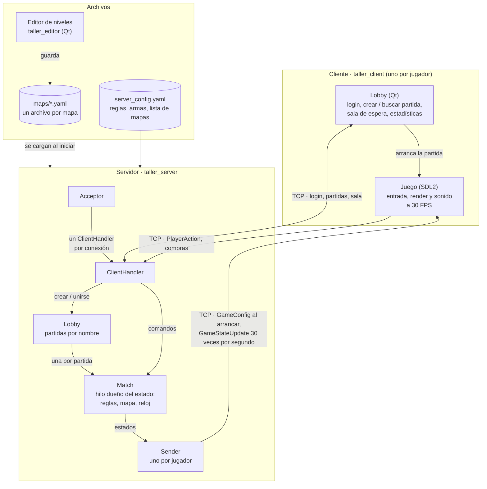
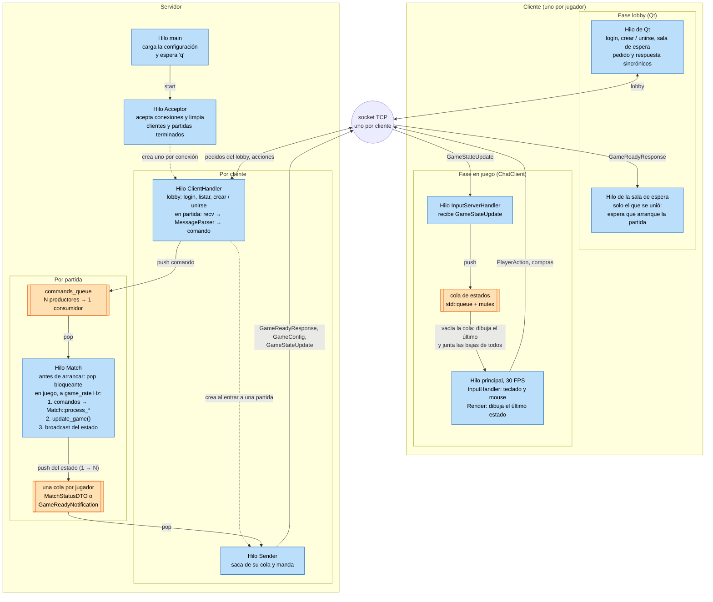
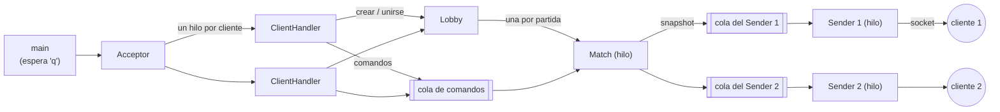
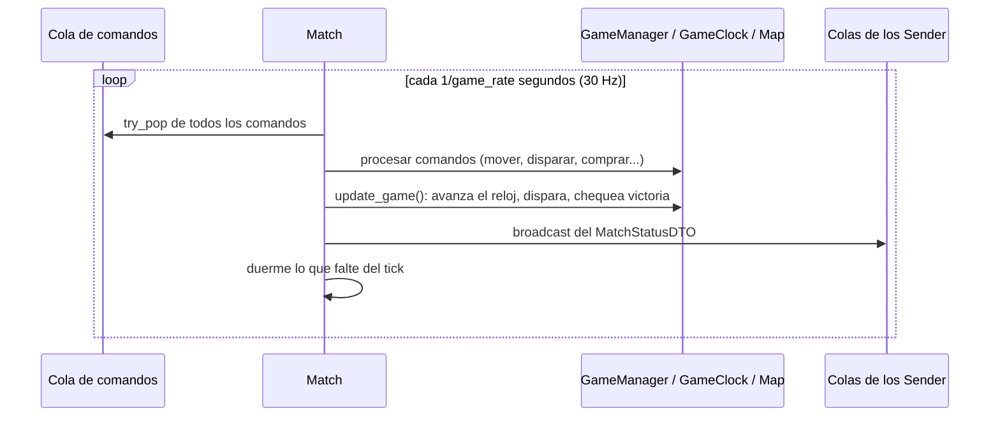
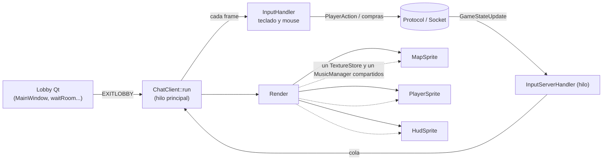
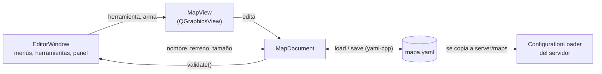

# Documentación técnica: Counter-Strike 2D

Taller de Programación, cátedra Veiga. Trabajo práctico final.
Integrantes: Martín Alejandro Estrada Saavedra (110530), Carlos Matías Sagastume (109236) y Manuel Herrera Esteban (109883).

## Visión general

El sistema son tres programas. El **servidor** tiene el estado de todas las partidas; cada jugador usa un **cliente** que se conecta por TCP; el **editor de niveles** no se conecta a nada y solo produce los archivos de mapa que lee el servidor. Cliente y servidor hablan con el mismo `Protocol` y los mismos mensajes de `common/`.



- **Del lado del cliente** hay dos fases en el mismo proceso: el lobby Qt hasta que arranca la partida y después el juego SDL, que dibuja lo que manda el servidor y le manda lo que hace el jugador ([sección 3](#3-arquitectura-del-cliente)).
- **Del lado del servidor**, cada partida es un hilo (`Match`) que es el único que cambia el estado del juego; los demás hilos solo le encolan comandos o reciben sus estados ([sección 2](#2-arquitectura-del-servidor)).
- **Entre los dos** viajan mensajes binarios con un encabezado de tipo y largo ([sección 4](#4-protocolo)).
- **El editor** arma mapas que el servidor carga al iniciar si figuran en `server_config.yaml` ([sección 5](#5-editor-de-niveles)).

### Hilos y colas

El mismo sistema, un nivel más abajo: qué hilos hay de cada lado y por qué colas se pasan los datos. En azul los hilos, en naranja las colas.



- **Cliente:** el hilo principal hace entrada y render (SDL exige manejar la ventana desde el hilo que la creó); el único otro hilo del juego es el que recibe del socket. En el lobby, Qt espera cada respuesta del servidor salvo en la sala de espera del que se unió, que espera el arranque en un hilo aparte para no congelar la ventana.
- **Servidor:** por cada cliente hay un `ClientHandler` (lo que llega del socket) y, desde que entra a una partida, un `Sender` (lo que sale). Cada partida es un hilo `Match`, el único que toca el estado del juego: recibe comandos por una cola compartida y reparte cada estado en una cola por jugador.

## 1. Tecnologías

- **C++20** y POSIX 2008, compilado con CMake.
- **Servidor**: hilos de la STL, sockets de la cátedra (`common/catedra`) y yaml-cpp para la configuración.
- **Cliente**: Qt6 para el lobby y SDL2 con libSDL2pp, SDL_image y SDL_mixer para el juego.
- **Editor de niveles**: Qt6 (`QGraphicsView`) y yaml-cpp para los archivos de mapa.
- **Tests**: GoogleTest (`tests/`).

Organización del repositorio:

| Carpeta | Contenido |
|---|---|
| `common/` | Protocolo, registro de mensajes, mensajes (`dto/`), `ByteWriter`/`ByteReader` (`serialization/`) y enums compartidos. `catedra/` tiene socket, cola bloqueante y thread. |
| `server/` | Acceptor, lobby, partidas, comandos y envío de estados. `game/` tiene la lógica del juego y `game/gun/` las armas. |
| `client/lobby/` | Pantallas Qt (login, lobby, crear partida, sala de espera, skins, estadísticas). |
| `client/graphics/` | Loop del juego, render, entrada, sonido y sprites. |
| `client/data/` | Imágenes y sonidos. |
| `editor/` | Editor de niveles: modelo del mapa (`MapDocument`, sin Qt) y la interfaz Qt. |
| `server/maps/` | Un archivo YAML por mapa (los que lista `server_config.yaml`). |
| `tools/` | Scripts que generan assets (textos del HUD, texturas de mapas, sonidos). |
| `tests/` | Tests del protocolo, de las reglas de ronda y del modelo del editor. |

## 2. Arquitectura del servidor

### Hilos



- **`Acceptor`** acepta conexiones y lanza un `ClientHandler` por cliente. Periódicamente libera los que terminaron y las partidas finalizadas (`Lobby::remove_finished_matches`).
- **`ClientHandler`** atiende al cliente en dos etapas:
  1. **Lobby** (`pick_match`): login, lista de partidas, nombres de mapas, crear o unirse. Responde directamente por el socket. Los nombres de usuario y de partida tienen hasta 32 bytes (`common/name_limits.h`): el de usuario se recorta y una partida con nombre vacío o más largo se rechaza.
  2. **Partida** (`handle_game`): traduce cada mensaje a un **comando** (`MessageParser`) y lo encola en la cola de comandos de la partida. También lanza su `Sender`.

El recorrido completo de una acción del jugador es: `ClientHandler` recibe el `PlayerAction` → `MessageParser` lo convierte en un comando (por ejemplo `ShootCommand`) → el comando entra en la cola → el hilo de `Match` lo saca y llama a `command->process_command(match)` → el comando llama al método de `Match` que le corresponde (`process_shoot_request`).
- **`Lobby`** guarda las partidas por nombre, protegidas por un mutex. Al crear una partida le pasa el mapa elegido. La lista que devuelve omite las partidas que ya empezaron y las que terminaron (por ejemplo, porque se fueron todos de la sala), y el nombre de una partida terminada se puede volver a usar enseguida. Un jugador que entró a una partida no vuelve al lobby con la misma conexión: si se va, el cliente termina.
- **`Match`** es el **único hilo que modifica el estado del juego**. Los clientes no lo tocan: solo encolan comandos (patrón *command*). Así se evitan las condiciones de carrera y los deadlocks entre jugadores.
- **`Sender`** saca snapshots de su cola y los serializa al socket del cliente. Al arrancar la partida manda primero `GameReadyResponse` y la configuración (`GameConfigInfo`).

### Loop de la partida



Antes de arrancar, `Match::wait_for_match_to_start` procesa comandos en forma bloqueante (skins, arranque). `GameReadyCommand` solo arranca la partida si hay al menos un jugador en cada equipo. Si no, le avisa únicamente al que lo pidió (`GameReadyNotification{false}`).

### Clases principales del servidor

| Clase | Responsabilidad |
|---|---|
| `GameConfig` / `ConfigurationLoader` | Leen `server_config.yaml`: valores numéricos, armas y la lista de mapas (`maps`). Cada `Match` tiene **su propia copia** con el mapa elegido (`GameConfig(base, mapa)`), compartida con los `Sender` por `shared_ptr`. |
| `Match` | Dueña de jugadores, mapa, reloj y reglas. Sus métodos públicos `process_*_request` son la entrada de los comandos: cada uno usa `with_player`, que toma el mutex, busca al jugador por sus credenciales y ejecuta la acción solo si sigue en la partida. Las credenciales salen de un contador que nunca se reutiliza. Antes de arrancar, la partida sigue mientras quede alguien en la sala; ya empezada, termina cuando queda uno solo. Avanza el juego y arma el `MatchStatusDTO`. |
| `GameClock` | Etapas de la ronda: `BuyStage` → `PrePlantStage` (con límite `round_time`) → `PostPlantStage` (cuenta regresiva de la bomba) → `AfterRoundStage`. Expone el **tiempo restante de la etapa**, que es lo que muestra el reloj del cliente. |
| `GameManager` | Reglas: victoria de ronda (eliminación, bomba, desactivación o tiempo agotado), dinero, cambio de bando en la ronda `number_of_rounds / 2 + 1`, fin de partida al llegar a la mitad + 1 de victorias (empate, `Team::None`, si nadie llega), plantado y desactivado, armas tiradas. Acumula las bajas (matador, víctima y arma) hasta que `Match` las saca con `take_kills` para mandarlas en el próximo estado. |
| `Map` | Estructuras (pueden superponerse), zonas de inicio, zonas de bomba y armas en el piso. Divide el mapa en *chunks* para buscar colisiones solo cerca. `trace_bullet_path` revisa todos los chunks que cruza la bala, intersecta el segmento del disparo con cada pared y jugador (`CollisionDetector::get_bullet_impact`) y se queda con el impacto más cercano. |
| `Player` | Estado del jugador: posición, vida, plata, armas, bomba, plantado y desactivado (con su avance `task_progress`), estadísticas. Sus campos son privados: `GameManager` lo modifica con métodos como `earn_money`, `start_defusing`, `stop_defusing`, `add_kill` y `receive_damage`. Al morir o al irse de la partida, `drop_all_weapons` deja en el piso la bomba y el arma principal. |
| `Gun` y derivadas | `Knife`, `Glock`, `Ak47` (ráfagas de `bullets_per_burst` balas separadas por `shoot_cooldown`, con `burst_cooldown` de pausa entre ráfagas), `M3` (cono de perdigones con alcance corto que respeta paredes), `Awp` (daño fijo) y `BombEncapsulator`. Cada arma calcula su daño, precisión y cadencia a partir de su `GunConfig`. |
| `MessageParser` / comandos | Convierten mensajes en `PlayerCommand` (`MovementCommand`, `ShootCommand`, `BuyWeaponCommand`, `DropWeaponCommand`, `AimCommand`, etc.). Cada comando llama directamente al método correspondiente de `Match`. |

## 3. Arquitectura del cliente



- El **lobby** es Qt: login, crear partida (eligiendo mapa), buscar partidas, sala de espera (skin y arranque) y, al final, la tabla de estadísticas. Si no se puede crear la partida, la ventana dice por qué. En la sala de espera, el que se unió espera el arranque en un hilo aparte; cerrar la sala antes de que arranque la partida es irse de ella (manda `DisconnectRequest`, cierra la conexión y el cliente termina), y si se corta la conexión aparece un aviso.
- **`ChatClient::run`** es un *constant rate loop* a 30 FPS en el hilo principal. En cada frame:
  1. `InputHandler::processFrame` procesa los eventos de SDL y el estado del teclado y manda las acciones. Corre en el hilo principal porque SDL lo exige para la ventana que creó.
  2. Vacía la cola de `InputServerHandler` y se queda con el **estado más nuevo**, para no arrastrar atraso si se juntaron varios. Antes de descartar los anteriores le pasa a `Render` sus bajas (`addKills`), porque cada una viaja en un solo estado.
  3. `Render::renderFrame` dibuja ese estado.

  `run` arma la ventana y los hilos; el loop está en `gameLoop` y lo que queda para la pantalla de estadísticas en `collectStatistics`.
- **`InputServerHandler`** es el único otro hilo: recibe `GameStateUpdate` del socket y los encola. Si la conexión se corta (`ConnectionClosed`), termina el juego ordenadamente.

### Clases principales del cliente

| Clase | Responsabilidad |
|---|---|
| `InputHandler` | Movimiento y acciones por estado del teclado: una tabla tecla → acción con prioridad (si hay varias apretadas gana la primera), más las diagonales en `diagonalMovement`. Compras y atajos (H, F11) por evento de tecla; Tab (mantener) muestra la tabla de puntajes. Click en la tienda durante la compra. Si solo se movió el mouse, manda `Action::Idle` con la mira para que el resto vea hacia dónde apunta. |
| `Render` | Dibuja cada frame por capas, en este orden: `updateCamera`, el mapa, `updateAim`, `drawBomb`, `drawPlayers` (con los sonidos de cada jugador), `drawHudLayer`, `drawWorldOverlays` (campo de visión o tienda, explosión, armas tiradas) y `drawFeedback` (barra de progreso, ayuda, registro de bajas, tabla de puntajes, flash de daño). Lo que se calcula una vez por frame viaja en `FrameContext`. Decide qué es visible (cono de visión + radio cercano, `pointInVision`). Es dueña del `TextureStore` y del `MusicManager`, que comparte con los sprites: el audio se abre una sola vez y cada imagen se carga una sola vez. |
| `MapSprite` | Piso y estructuras del tema del mapa (`maps/<theme>/floor.png` y `wall.png`), zonas, bomba, cono de visión y tienda. |
| `PlayerSprite` | Jugadores, armas, disparos (trazo desde la boca del arma hasta el impacto con fogonazo, y el cono del M3) y sonidos de disparo, pasos y muerte. |
| `HudSprite` | Vida, plata, arma y munición, reloj (en rojo con la bomba), barra de plantar o desactivar, ayuda de controles, registro de bajas y tabla de puntajes (Tab). El texto se dibuja con una fuente de mapa de bits (`hud/font.png`, generada por `tools/generate_hud_images.py`). |
| `Configuration` | Tamaño de ventana, zoom, cámara, rectángulos de la tienda y la ayuda, y el radio del campo de visión. |
| `MusicManager` | Carga y reproduce sonidos en 32 canales; un sonido que no cargó se saltea. `volumeForDistance` atenúa linealmente según la distancia al jugador. |

## 4. Protocolo

Ambos lados usan `Protocol`, que envía y recibe `Message`. Cada mensaje viaja como

```
tipo (MessageType, 1 byte) | largo del payload (uint16) | payload
```

- **Formato de los campos:** todo valor multi-byte va en **orden de red** (big-endian), incluidos los `float`, que viajan como sus 32 bits. Un texto es su largo (`uint16`) seguido de los bytes, y una lista es la cantidad de elementos (`uint16`; `uint32` en la configuración del mapa) seguida de cada elemento. Los enums ocupan 1 byte y los `bool` también.
- **`ByteWriter` / `ByteReader`** (`common/serialization/`) implementan ese formato en un solo lugar. El lector controla los límites: si a un mensaje le faltan bytes o un largo no entra en lo que queda, lanza **`ProtocolError`** en vez de leer fuera del buffer.
- **Cada mensaje describe sus campos:** `Message` tiene `type()` y `write_payload(ByteWriter&)`, y cada mensaje concreto expone `static X read_payload(ByteReader&)`. Las estructuras anidadas (`PlayerInfo`, `GunConfigInfo`, `MapConfigInfo`, etc.) tienen `write`/`read`. El encabezado lo pone `Protocol`, que también rechaza un payload de más de 65535 bytes.
- **Registro de mensajes** (`common/message_registry.cpp`): una tabla de tipo a función de lectura. Al recibir, `Protocol` lee el encabezado y el payload y le pide el mensaje al registro. Si el tipo no existe o sobran bytes, se lanza `ProtocolError`.
- **Mensajes repetidos como plantillas** (`dto/simple_messages.h`): los pedidos sin datos son `EmptyMessage<Tipo>` y las respuestas de un solo `bool` son `SuccessResponse<Tipo>`, con alias que conservan los nombres (`GameListRequest`, `JoinGameResponse`, ...).
- Si el socket se cierra antes de que llegue un mensaje completo, `Protocol` lanza `ConnectionClosed`.

**Agregar un mensaje:**

1. Sumar el tipo a `MessageType`.
2. Crear la clase heredando de `MessageOf<MessageType::X>`, con `write_payload` y `read_payload`, escribiendo y leyendo los campos en el mismo orden.
3. Agregar `entry<X>()` a la tabla de `message_registry.cpp`.

`Protocol` no cambia.

| Cliente → Servidor | Servidor → Cliente |
|---|---|
| `LoginRequest`, `MapNamesRequest`, `GameListRequest`, `CreateGameRequest` (nombre + mapa), `JoinGameRequest`, `SelectSkinRequest`, `GameReadyRequest`, `BuyWeaponRequest`, `BuyAmmoRequest`, `PlayerAction`, `DisconnectRequest` | `LoginResponse`, `MapNamesResponse`, `GameListResponse`, `CreateGameResponse`, `JoinGameResponse` (falla si la partida está llena o empezada), `GameReadyResponse` (falla si falta un equipo), `GameConfig`, `GameStateUpdate` |

**`PlayerAction`** lleva la acción y la posición del mouse en el mapa. Acciones: `MoveUp/Down/Left/Right`, `Shoot`, `Reload`, `EquipWeapon` (levantar), `SetKnife/PrimaryWeapon/SecondaryWeapon/Bomb`, `DefuseBomb`, `DropWeapon` (G), `Idle` (solo actualiza la mira).

**`GameStateUpdate`** (snapshot, 30 por segundo) contiene: partida iniciada o terminada, ronda, tiempo transcurrido, inicio y fin de ronda, bomba plantada y su posición, timer de la bomba, ganador de la ronda y de la partida (`Team::None` si terminó empatada), **etapa de la ronda** (`RoundStage`) y **tiempo restante de la etapa**, la lista de `PlayerInfo`, la lista de armas en el piso y las **bajas desde el estado anterior** (`KillInfo`: matador, víctima y arma; el matador queda vacío si mató la bomba). `GameManager` acumula las bajas y `Match` las saca al armar cada estado, así cada una viaja una sola vez; el cliente junta las de todos los estados que recibe, no solo las del último que dibuja.

**`PlayerInfo`**: nombre, posición, vida, estado, plata, kills, muertes, última acción, posición de la mira, skin, armas con su munición, arma activa y **`task_progress`** (0 a 100, avance del plantado o desactivado).

**`GameConfigInfo`** se manda una vez al arrancar: vida, rondas, plata, cantidades por equipo, precio de balas, la configuración de cada arma (`GunConfigInfo`: daño, precio, cadencia, alcance, ángulo, munición), tiempos de la partida, cono de visión y el **`MapConfigInfo`** (nombre, tamaño, estructuras, zonas de inicio, la **lista de zonas de bomba** y tema visual).

## 5. Editor de niveles

Tercera aplicación (`taller_editor`). No se conecta al servidor: produce archivos de mapa que después se copian a la carpeta de mapas del servidor.



| Clase | Responsabilidad |
|---|---|
| `MapDocument` (`editor/map_document.*`) | Modelo del mapa, **sin Qt** (biblioteca `editor_model`, para poder testearlo): nombre, terreno, tamaño, estructuras, zonas de bomba, zonas de inicio con spawns y armas, todo en tiles. `load`/`save` usan el mismo esquema que el servidor. `validate()` devuelve errores (impiden guardar: falta una zona de inicio, zona sin spawns o con spawns afuera, spawn tapado, sin zona de bomba, elementos fuera del mapa, arma debajo de una estructura) y avisos (menos de 5 spawns, zona de bomba con estructuras encima). |
| `MapView` (`editor/map_view.*`) | Dibuja el documento con las texturas del juego y lo edita según la herramienta: arrastrar para dibujar rectángulos, click para spawns y armas, drag and drop para mover, tirador para redimensionar. La escena solo define el tamaño del mapa; el dibujo se hace en `drawBackground`/`drawForeground` a partir del documento, así no hay que sincronizar objetos gráficos con el modelo. `QGraphicsView` aporta el scroll y el zoom (Ctrl + rueda). |
| `EditorWindow` (`editor/editor_window.*`) | Menú de archivo (abrir y guardar con `QFileDialog`), barra de herramientas, propiedades del mapa y lista de validación, que se actualiza con cada cambio. Antes de guardar exige que `validate()` no tenga errores. |

### Formato del archivo de mapa

```yaml
map_name: entrenamiento          # nombre que se ve al crear la partida
theme: training                  # desert | aztec_village | training (texturas en client/data/maps/<theme>/)
map_width: 110                   # tamaño en tiles
map_height: 110
structures:                      # estructuras sólidas
  - {x: 51, y: 51, width: 8, height: 8}
bomb_sites:                      # una o más zonas para plantar
  - {x: 42, y: 4, width: 26, height: 22}
tt_site:                         # zona de inicio terrorista y sus spawns
  x: 4
  y: 40
  width: 24
  height: 30
  spawns:
    - {x: 6, y: 44}
ct_site: {...}                   # igual para los antiterroristas
weapon_drops:                    # armas en el piso al comenzar: ak-47, m3 o awp
  - {name: m3, x: 55, y: 95}
```

## 6. Configuración y assets

- `server/server_config.yaml` (instalado en `/etc/cs2d/`) contiene todos los valores numéricos y la sección `maps` con las rutas de los mapas, relativas a la carpeta del archivo (`maps/desierto.yaml`, etc.; también acepta un mapa escrito directamente en la lista). Para agregar un mapa alcanza con crearlo en el editor, copiarlo a `maps/` y sumarlo a la lista. Un **tema visual** nuevo necesita además las texturas `client/data/maps/<theme>/floor.png` (mosaico de tiles de 32 px que se repite por todo el mapa) y `wall.png` (tile de 32×32 que se repite sobre cada estructura).
- Assets generados por scripts, que se pueden regenerar:
  - `tools/generate_map_textures.py`: piso y pared de los temas `desert`, `aztec_village` y `training`, armados con tiles de los tilesets originales del CS2D (`client/data/maps/tilesets/`: dust, aztec y cs2dnorm). El cliente y el editor los dibujan en mosaico a 8 px de textura por tile, así un tile de 32 px ocupa lo mismo que un jugador;
  - `tools/generate_hud_images.py`: ayuda de controles, carteles de plantar y desactivar, y la fuente de mapa de bits `font.png` (DejaVu Sans Mono, solo ASCII) con la que el cliente escribe el registro de bajas y la tabla de puntajes;
  - `tools/generate_sounds.py`: `reload.wav`, que une `w_clipout.wav` y `w_clipin.wav` del CS2D.
- Los sonidos son los originales del CS2D (`client/data/sounds/`): disparos, cuchillo, recarga, muerte y daño (`die1-3`, `hit1-3`, elegidos al azar), pasos (`pl_step1-4`), pitido y explosión de la bomba (`c4`, `c4_explode`), gatillo sin balas (`click`) y levantar y tirar armas (`pickup`, `drop`).

## 7. Tests

- `tests/test_byte_io.cpp`: `ByteWriter`/`ByteReader`: bytes exactos en orden de red, ida y vuelta de cada tipo y lecturas truncadas.
- `tests/test_protocol.cpp`: sobre un socket simulado (`MockSocket`): bytes exactos de algunos mensajes, ida y vuelta de todos los tipos de mensaje y mensajes mal formados (tipo desconocido, truncado, texto más largo que el payload, bytes de más, payload demasiado grande).
- `tests/test_game_rules.cpp`: reglas sobre la lógica real del servidor:
  - **rondas:** cuenta regresiva por etapa, vencimiento del tiempo de ronda, victoria CT por tiempo, cambio de bando y premio de la ronda del medio tiempo, fin de partida y empate;
  - **bomba:** duración, plantar y desactivar manteniendo la tecla, no plantar fuera de una zona ni con la ronda terminada, desactivar de más sin trabar el fin de ronda, tirarla y levantarla;
  - **disparos y armas:** disparos verticales y horizontales, paredes superpuestas, ráfagas de la AK, armas que se tiran al morir y no se pisan al levantar;
  - **bajas:** cada una se informa una vez, con el arma del matador o sin matador si fue la bomba.
- `tests/test_map_document.cpp`: el modelo del editor: guardar y abrir da el mismo mapa, cada regla de validación, los mapas de `server/maps/` son válidos y el `ConfigurationLoader` del servidor carga un mapa guardado por el editor.

```bash
make run-tests
```
