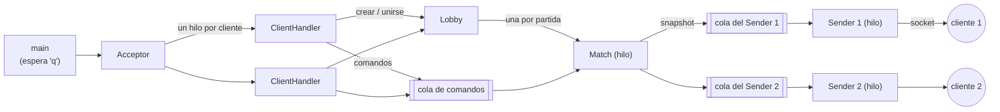
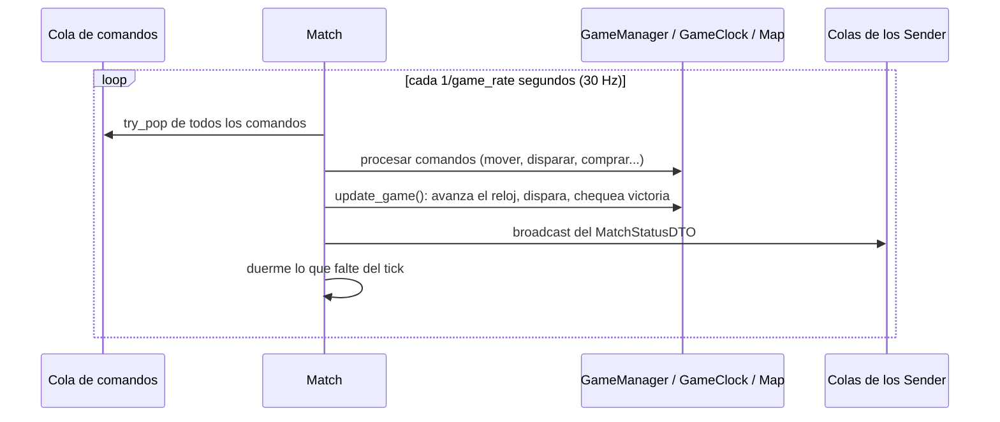
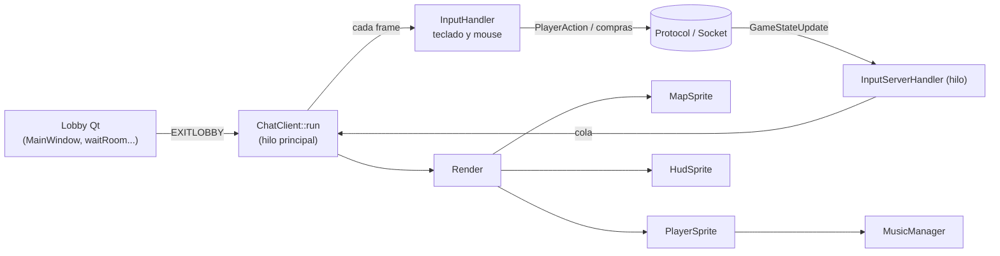
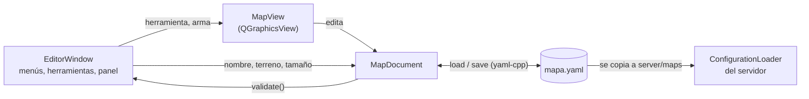

# Documentación técnica: Counter-Strike 2D

Taller de Programación, cátedra Veiga. Trabajo práctico final.
Integrantes: Martín Alejandro Estrada Saavedra (110530), Carlos Matías Sagastume (109236) y Manuel Herrera Esteban (109883).

## 1. Tecnologías

- **C++20** y POSIX 2008, compilado con CMake.
- **Servidor**: hilos de la STL, sockets de la cátedra (`common/catedra`) y yaml-cpp para la configuración.
- **Cliente**: Qt6 para el lobby y SDL2 con libSDL2pp, SDL_image y SDL_mixer para el juego.
- **Editor de niveles**: Qt6 (`QGraphicsView`) y yaml-cpp para los archivos de mapa.
- **Tests**: GoogleTest (`tests/`).

Organización del repositorio:

| Carpeta | Contenido |
|---|---|
| `common/` | Protocolo, mensajes (`dto/`) y enums compartidos. `catedra/` tiene socket, cola bloqueante y thread. |
| `server/` | Acceptor, lobby, partidas, comandos y envío de estados. `game/` tiene la lógica del juego y `game/gun/` las armas. |
| `client/lobby/` | Pantallas Qt (login, lobby, crear partida, sala de espera, skins, estadísticas). |
| `client/graphics/` | Loop del juego, render, entrada, sonido y sprites. |
| `client/data/` | Imágenes y sonidos. |
| `editor/` | Editor de niveles: modelo del mapa (`MapDocument`, sin Qt) y la interfaz Qt. |
| `server/maps/` | Un archivo YAML por mapa (los que lista `server_config.yaml`). |
| `tools/` | Scripts que generan assets (textos del HUD, texturas de mapas, sonidos). |
| `tests/` | Tests del protocolo, de las reglas de ronda y del modelo del editor. |

## 2. Arquitectura del servidor

### Hilos



- **`Acceptor`** acepta conexiones y lanza un `ClientHandler` por cliente. Periódicamente libera los que terminaron y las partidas finalizadas (`Lobby::remove_finished_matches`).
- **`ClientHandler`** atiende al cliente en dos etapas:
  1. **Lobby** (`pick_match`): login, lista de partidas, nombres de mapas, crear o unirse. Responde directamente por el socket.
  2. **Partida** (`handle_game`): traduce cada mensaje a un **comando** (`MessageParser`) y lo encola en la cola de comandos de la partida. También lanza su `Sender`.
- **`Lobby`** guarda las partidas por nombre, protegidas por un mutex. Al crear una partida le pasa el mapa elegido. La lista que devuelve omite las partidas que ya empezaron.
- **`Match`** es el **único hilo que modifica el estado del juego**. Los clientes no lo tocan: solo encolan comandos (patrón *command*). Así se evitan las condiciones de carrera y los deadlocks entre jugadores.
- **`Sender`** saca snapshots de su cola y los serializa al socket del cliente. Al arrancar la partida manda primero `GameReadyResponse` y la configuración (`GameConfigInfo`).

### Loop de la partida



Antes de arrancar, `Match::wait_for_match_to_start` procesa comandos en forma bloqueante (skins, arranque). `GameReadyCommand` solo arranca la partida si hay al menos un jugador en cada equipo. Si no, le avisa únicamente al que lo pidió (`GameReadyNotification{false}`).

### Clases principales del servidor

| Clase | Responsabilidad |
|---|---|
| `GameConfig` / `ConfigurationLoader` | Leen `server_config.yaml`: valores numéricos, armas y la lista de mapas (`maps`). Cada `Match` tiene **su propia copia** con el mapa elegido (`GameConfig(base, mapa)`), compartida con los `Sender` por `shared_ptr`. |
| `Match` | Dueña de jugadores, mapa, reloj y reglas. Procesa los comandos (`process_*_request`, todos bajo su mutex), avanza el juego y arma el `MatchStatusDTO`. |
| `GameClock` | Etapas de la ronda: `BuyStage` → `PrePlantStage` (con límite `round_time`) → `PostPlantStage` (cuenta regresiva de la bomba) → `AfterRoundStage`. Expone el **tiempo restante de la etapa**, que es lo que muestra el reloj del cliente. |
| `GameManager` | Reglas: victoria de ronda (eliminación, bomba, desactivación o tiempo agotado), dinero, cambio de bando en la ronda `number_of_rounds / 2 + 1`, fin de partida al llegar a la mitad + 1 de victorias, plantado y desactivado, armas tiradas. |
| `Map` | Estructuras, zonas de inicio, zona de la bomba y armas en el piso. Divide el mapa en *chunks* para buscar colisiones solo cerca. `trace_bullet_path` recorre la trayectoria de una bala hasta la primera pared o jugador. |
| `Player` | Estado del jugador: posición, vida, plata, armas, bomba, plantado y desactivado (con su avance `task_progress`), estadísticas. |
| `Gun` y derivadas | `Knife`, `Glock`, `Ak47` (ráfagas), `M3` (cono de perdigones con alcance corto que respeta paredes), `Awp` (daño fijo) y `BombEncapsulator`. Cada arma calcula su daño, precisión y cadencia a partir de su `GunConfig`. |
| `MessageParser` / comandos | Convierten mensajes en `PlayerCommand` (`MovementCommand`, `ShootCommand`, `BuyWeaponCommand`, `DropWeaponCommand`, `AimCommand`, etc.). Cada comando llama al método correspondiente de `Match` a través de `RequestProcessor`. |

## 3. Arquitectura del cliente



- El **lobby** es Qt: login, crear partida (eligiendo mapa), buscar partidas, sala de espera (skin y arranque) y, al final, la tabla de estadísticas.
- **`ChatClient::run`** es un *constant rate loop* a 30 FPS en el hilo principal. En cada frame:
  1. `InputHandler::processFrame` procesa los eventos de SDL y el estado del teclado y manda las acciones. Corre en el hilo principal porque SDL lo exige para la ventana que creó.
  2. Vacía la cola de `InputServerHandler` y se queda con el **estado más nuevo**, para no arrastrar atraso si se juntaron varios.
  3. `Render::renderFrame` dibuja ese estado.
- **`InputServerHandler`** es el único otro hilo: recibe `GameStateUpdate` del socket y los encola. Si la conexión se corta (`ConnectionClosed`), termina el juego ordenadamente.

### Clases principales del cliente

| Clase | Responsabilidad |
|---|---|
| `InputHandler` | Movimiento y acciones por estado del teclado. Compras y atajos (H, F11) por evento de tecla. Click en la tienda durante la compra. Si solo se movió el mouse, manda `Action::Idle` con la mira para que el resto vea hacia dónde apunta. |
| `Render` | Ubica la cámara sobre el jugador, decide qué es visible (cono de visión + radio cercano, `pointInVision`) y coordina sprites, HUD, sangre, explosión y sonidos por distancia. |
| `MapSprite` | Piso y estructuras del tema del mapa (`maps/<theme>/floor.png` y `wall.png`), zonas, bomba, cono de visión y tienda. |
| `PlayerSprite` | Jugadores, armas, disparos (incluye el cono del M3) y sonidos de disparo, pasos y muerte. |
| `HudSprite` | Vida, plata, arma y munición, reloj (en rojo con la bomba), barra de plantar o desactivar, ayuda de controles. |
| `Configuration` | Tamaño de ventana, zoom, cámara, rectángulos de la tienda y la ayuda, y el radio del campo de visión. |
| `MusicManager` | Carga y reproduce sonidos. `volumeForDistance` atenúa linealmente según la distancia al jugador. |

## 4. Protocolo

Ambos lados usan `Protocol`, que envía y recibe `Message` (clase abstracta con `serialize`, `deserialize` y `serialized_size`). Cada mensaje viaja con un encabezado de 3 bytes: el tipo (`MessageType`, 1 byte) y el largo del payload (uint16 en orden de red). Los enteros multi-byte van en orden de red. Si al leer el encabezado el socket ya está cerrado, `Protocol` lanza `ConnectionClosed`.

| Cliente → Servidor | Servidor → Cliente |
|---|---|
| `LoginRequest`, `MapNamesRequest`, `GameListRequest`, `CreateGameRequest` (nombre + mapa), `JoinGameRequest`, `SelectSkinRequest`, `GameReadyRequest`, `BuyWeaponRequest`, `BuyAmmoRequest`, `PlayerAction`, `DisconnectRequest` | `LoginResponse`, `MapNamesResponse`, `GameListResponse`, `CreateGameResponse`, `JoinGameResponse` (falla si la partida está llena o empezada), `GameReadyResponse` (falla si falta un equipo), `GameConfig`, `GameStateUpdate` |

**`PlayerAction`** lleva la acción y la posición del mouse en el mapa. Acciones: `MoveUp/Down/Left/Right`, `Shoot`, `Reload`, `EquipWeapon` (levantar), `SetKnife/PrimaryWeapon/SecondaryWeapon/Bomb`, `DefuseBomb`, `DropWeapon` (G), `Idle` (solo actualiza la mira).

**`GameStateUpdate`** (snapshot, 30 por segundo) contiene: partida iniciada o terminada, ronda, tiempo transcurrido, inicio y fin de ronda, bomba plantada y su posición, timer de la bomba, ganador de la ronda y de la partida, **etapa de la ronda** (`RoundStage`) y **tiempo restante de la etapa**, la lista de `PlayerInfo` y la lista de armas en el piso.

**`PlayerInfo`**: nombre, posición, vida, estado, plata, kills, muertes, última acción, posición de la mira, skin, armas con su munición, arma activa y **`task_progress`** (0 a 100, avance del plantado o desactivado).

**`GameConfigInfo`** se manda una vez al arrancar: vida, rondas, plata, cantidades por equipo, precio de balas, la configuración de cada arma (`GunConfigInfo`: daño, precio, cadencia, alcance, ángulo, munición), tiempos de la partida, cono de visión y el **`MapConfigInfo`** (nombre, tamaño, estructuras, zonas de inicio, la **lista de zonas de bomba** y tema visual).

## 5. Editor de niveles

Tercera aplicación (`taller_editor`). No se conecta al servidor: produce archivos de mapa que después se copian a la carpeta de mapas del servidor.



| Clase | Responsabilidad |
|---|---|
| `MapDocument` (`editor/map_document.*`) | Modelo del mapa, **sin Qt** (biblioteca `editor_model`, para poder testearlo): nombre, terreno, tamaño, estructuras, zonas de bomba, zonas de inicio con spawns y armas, todo en tiles. `load`/`save` usan el mismo esquema que el servidor. `validate()` devuelve errores (impiden guardar: falta una zona de inicio, zona sin spawns o con spawns afuera, spawn tapado, sin zona de bomba, elementos fuera del mapa, arma debajo de una estructura) y avisos (menos de 5 spawns, zona de bomba con estructuras encima). |
| `MapView` (`editor/map_view.*`) | Dibuja el documento con las texturas del juego y lo edita según la herramienta: arrastrar para dibujar rectángulos, click para spawns y armas, drag and drop para mover, tirador para redimensionar. La escena solo define el tamaño del mapa; el dibujo se hace en `drawBackground`/`drawForeground` a partir del documento, así no hay que sincronizar objetos gráficos con el modelo. `QGraphicsView` aporta el scroll y el zoom (Ctrl + rueda). |
| `EditorWindow` (`editor/editor_window.*`) | Menú de archivo (abrir y guardar con `QFileDialog`), barra de herramientas, propiedades del mapa y lista de validación, que se actualiza con cada cambio. Antes de guardar exige que `validate()` no tenga errores. |

### Formato del archivo de mapa

```yaml
map_name: entrenamiento          # nombre que se ve al crear la partida
theme: training                  # desert | aztec_village | training (texturas en client/data/maps/<theme>/)
map_width: 110                   # tamaño en tiles
map_height: 110
structures:                      # estructuras sólidas
  - {x: 51, y: 51, width: 8, height: 8}
bomb_sites:                      # una o más zonas para plantar
  - {x: 42, y: 4, width: 26, height: 22}
tt_site:                         # zona de inicio terrorista y sus spawns
  x: 4
  y: 40
  width: 24
  height: 30
  spawns:
    - {x: 6, y: 44}
ct_site: {...}                   # igual para los antiterroristas
weapon_drops:                    # armas en el piso al comenzar: ak-47, m3 o awp
  - {name: m3, x: 55, y: 95}
```

## 6. Configuración y assets

- `server/server_config.yaml` (instalado en `/etc/cs2d/`) contiene todos los valores numéricos y la sección `maps` con las rutas de los mapas, relativas a la carpeta del archivo (`maps/desierto.yaml`, etc.; también acepta un mapa escrito directamente en la lista). Para agregar un mapa alcanza con crearlo en el editor, copiarlo a `maps/` y sumarlo a la lista. Un **tema visual** nuevo necesita además las texturas `client/data/maps/<theme>/floor.png` (un píxel por tile, del tamaño del mapa) y `wall.png` (baldosa de 32×32).
- Assets generados por scripts, que se pueden regenerar:
  - `tools/generate_map_textures.py`: texturas de los temas `desert`, `aztec_village` y `training`;
  - `tools/generate_hud_images.py`: ayuda de controles y carteles de plantar y desactivar;
  - `tools/generate_sounds.py`: sonido de muerte y paso corto.

## 7. Tests

- `tests/test_protocol.cpp`: serialización y deserialización de los mensajes, usando un socket simulado (`MockSocket`).
- `tests/test_game_rules.cpp`: reglas sobre la lógica real del servidor: cuenta regresiva por etapa, vencimiento del tiempo de ronda, victoria CT por tiempo, cambio de bando a la mitad, fin de partida, duración de la bomba, plantar y desactivar manteniendo la tecla, no plantar fuera de una zona, y tirar y levantar la bomba.
- `tests/test_map_document.cpp`: el modelo del editor: guardar y abrir da el mismo mapa, cada regla de validación, los mapas de `server/maps/` son válidos y el `ConfigurationLoader` del servidor carga un mapa guardado por el editor.

```bash
make run-tests
```
