# Manual de usuario: Counter-Strike 2D

> Dos equipos, una bomba y diez rondas para demostrar quién manda.

Los **terroristas** quieren plantar una bomba en la zona marcada y defenderla hasta que explote. Los **antiterroristas** quieren impedirlo o, si llegan tarde, desactivarla a tiempo. Gana la partida el equipo que se lleve más rondas.

---

## Tu primera partida en 5 minutos

1. **Levantá el servidor** (una sola persona lo hace):
   ```bash
   ./server.sh
   ```
2. **Abrí el cliente** (cada jugador, en otra terminal o en otra compu):
   ```bash
   ./client.sh
   ```
3. **Entrá con tu nombre.** Hacé click en *Login*, escribí tu usuario y apretá *Sign up*.

   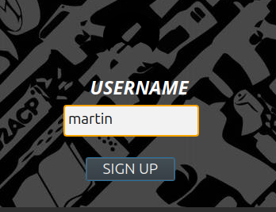

4. **Creá una partida.** Ponele un nombre y elegí uno de los tres escenarios: *desierto*, *pueblo-azteca* o *entrenamiento*.

   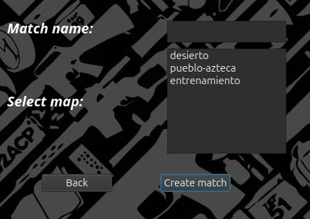

5. **Tus amigos se suman** desde *Search match*: eligen tu partida en la lista y hacen click en *Join match*. En la lista se ve el mapa y cuántos jugadores hay. Las partidas que ya empezaron no aparecen.

   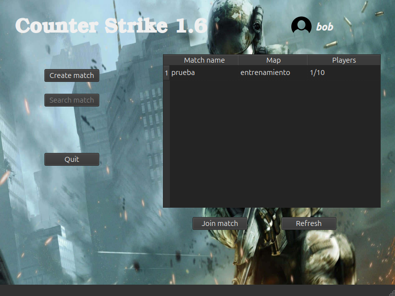

6. **Elegí tu skin** en la sala de espera. El equipo lo arma el servidor automáticamente, para que queden parejos.

   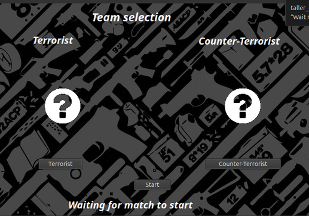

7. **¡A jugar!** Quien creó la partida aprieta *Start* y confirma. Hace falta al menos un jugador en cada equipo; si no, el juego avisa que faltan jugadores.

   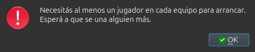

---

## Cómo es una ronda

| Momento | Qué pasa | Reloj |
|---|---|---|
| **Compra** (20 s) | Aparece la tienda. Comprás armas y balas, todavía no se puede disparar. | Cuenta regresiva de la compra |
| **Ronda** (1:55) | Los terroristas buscan la zona de la bomba y los antiterroristas la defienden. | Cuenta regresiva de la ronda |
| **Bomba plantada** (40 s) | Los antiterroristas tienen ese tiempo para desactivarla. | El reloj se pone **rojo** con el ícono de la bomba |
| **Fin de ronda** | Se muestra quién ganó y se arranca la siguiente. | |

Una ronda termina cuando:

- un equipo se queda sin jugadores vivos;
- la bomba explota (ganan los terroristas);
- la bomba es desactivada (ganan los antiterroristas);
- se acaba el tiempo sin que se plante la bomba (ganan los antiterroristas).

**A mitad de partida los equipos cambian de bando**: después de la ronda 5, los terroristas pasan a ser antiterroristas y viceversa. Con 10 rondas, gana el primero en llegar a 6.

### Plata

Arrancás con $2000. Ganás $600 por cada baja y al terminar cada ronda ($600 si tu equipo ganó, $200 si perdió). Las armas y las balas que compraste se mantienen entre rondas mientras sigas vivo. Si morís, tu arma queda tirada en el piso para quien la quiera levantar, y volvés con cuchillo y glock.

---

## Controles

Al empezar la partida aparece esta ayuda en pantalla. Se cierra sola al terminar la primera compra y la podés volver a abrir con **H**.

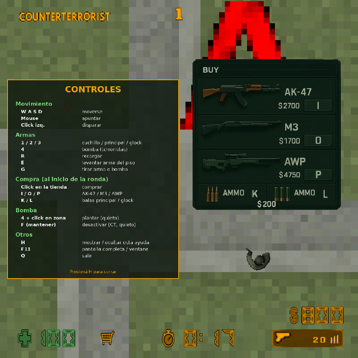

| Tecla | Acción |
|---|---|
| **W A S D** | Moverse |
| **Mouse** | Apuntar |
| **Click izquierdo** | Disparar (con la AK, mantener para ráfagas) |
| **1 / 2 / 3** | Cuchillo / arma principal / glock |
| **4** | Bomba (solo terroristas) |
| **R** | Recargar |
| **E** | Levantar el arma que está en el piso |
| **G** | Tirar el arma principal o la bomba |
| **F** (mantener) | Desactivar la bomba (antiterroristas) |
| **H** | Mostrar / ocultar la ayuda |
| **F11** | Alternar pantalla completa y ventana |
| **Q** | Salir |

### Comprar

Durante la fase de compra podés **hacer click en la tienda** o usar el teclado:

| Tecla | Compra | Precio |
|---|---|---|
| **I** | AK-47 | $2700 |
| **O** | M3 | $1700 |
| **P** | AWP | $4750 |
| **K** | Balas para el arma principal | $200 |
| **L** | Balas para la glock | $200 |

Si ya tenías un arma principal y comprás otra, la vieja queda tirada en el piso.

### La bomba

- **Plantar** (terroristas): equipá la bomba con **4**, parate dentro de la zona marcada y hacé click. Aparece una barra *"PLANTANDO BOMBA"*. Si te movés, se cancela.
- **Desactivar** (antiterroristas): parate al lado de la bomba y mantené **F**. Aparece la barra *"DESACTIVANDO BOMBA"* y suena el desarme. Si te movés, se corta.
- **Tirarla**: con la bomba equipada, apretá **G** para dejarla en el piso y que la levante un compañero con **E**.

---

## Las armas

| Arma | Para qué sirve |
|---|---|
| **Cuchillo** | Siempre lo tenés. Solo pega si estás pegado al rival. |
| **Glock** | Pistola inicial: un tiro por click, más daño que el cuchillo. |
| **AK-47** | Ráfagas de 3 balas. El daño baja con la distancia. |
| **M3** | Escopeta: dispara un **cono de perdigones** de alcance corto (se ven los trazos al disparar). Devastadora de cerca y no atraviesa paredes. |
| **AWP** | Francotirador: el arma más cara, con el mayor alcance y daño, que no depende de la distancia. |

---

## Los escenarios

- **Desierto**: el mapa grande y abierto, con calles largas.

  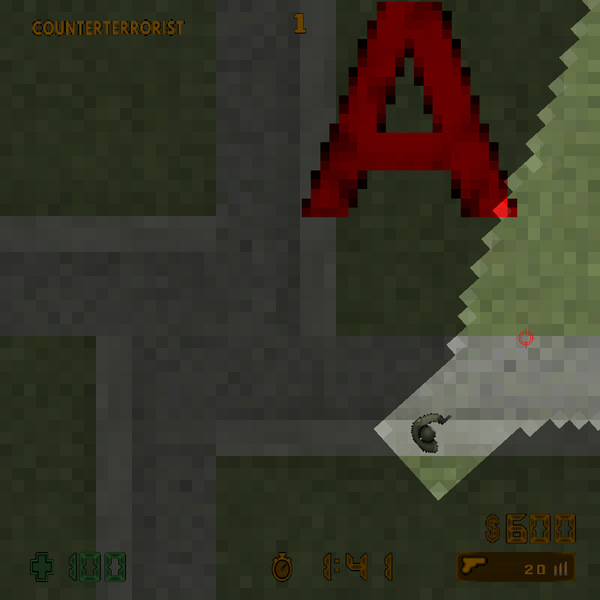

- **Pueblo azteca**: plaza de piedra con una pirámide en el centro y columnas para cubrirse.
- **Entrenamiento**: mapa chico, con piso cuadriculado y cajas. Ideal para partidas rápidas.

  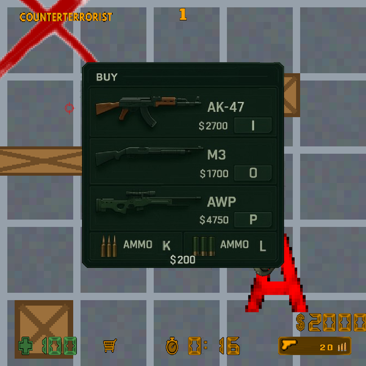

En todos verás tu **cono de visión**: lo que queda fuera del cono se ve oscuro y los rivales que están ahí no se muestran, salvo que estén pegados a vos. Los sonidos (disparos, pasos, muertes) se escuchan más fuerte cuanto más cerca ocurren, así que **prestá atención al ruido**.

Al terminar la partida se muestra una tabla con las bajas, las muertes, la diferencia **K-D** (bajas menos muertes) y la plata de cada jugador.

Cada escenario tiene **dos zonas de bomba** (A y B): los terroristas pueden plantar en cualquiera de las dos.

---

## Editor de niveles: creá tus propios mapas

El juego trae un editor para diseñar escenarios nuevos: el terreno, las estructuras, las armas tiradas, dónde arranca cada equipo y las zonas de bomba.

```bash
./editor.sh
```

(Desde el código: `./taller_editor` dentro de la carpeta `build`. Le podés pasar un mapa para abrirlo directamente: `./taller_editor ../server/maps/entrenamiento.yaml`.)

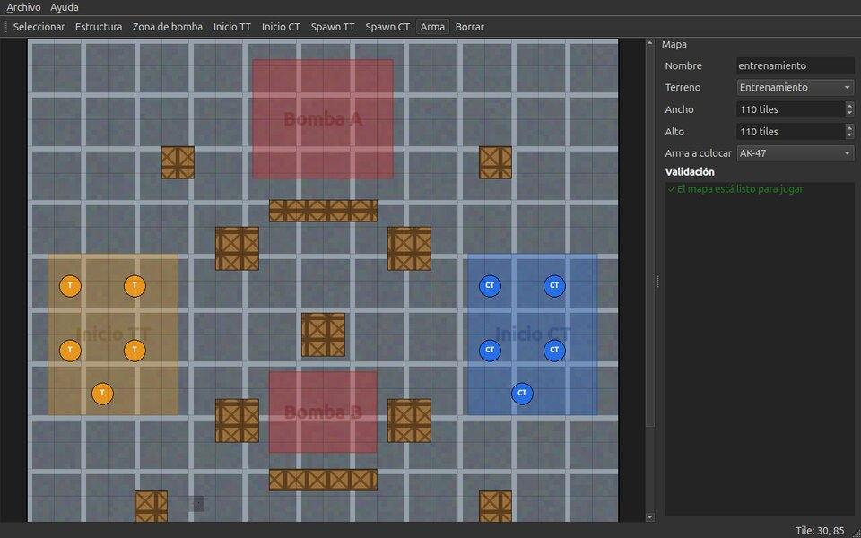

### Herramientas

Se eligen en la barra de arriba o con las teclas **1 a 9**:

| Tecla | Herramienta | Cómo se usa |
|---|---|---|
| **1** | Seleccionar | Arrastrá cualquier elemento para moverlo. Arrastrá el cuadradito blanco de la esquina para cambiarle el tamaño. **Supr** borra lo seleccionado. |
| **2** | Estructura | Arrastrá para dibujar una pared o caja (los jugadores y las balas no la atraviesan). |
| **3** | Zona de bomba | Arrastrá para dibujar una zona donde se puede plantar. Podés poner varias (A, B...). |
| **4** / **5** | Inicio TT / Inicio CT | Arrastrá para dibujar la zona de inicio de cada equipo. Hay una sola por equipo: dibujar otra la reemplaza. |
| **6** / **7** | Spawn TT / Spawn CT | Click donde aparece un jugador (dentro de su zona). Conviene poner 5 por equipo. |
| **8** | Arma | Click donde querés dejar un arma tirada. El tipo (AK-47, M3 o AWP) se elige en el panel derecho. |
| **9** | Borrar | Click sobre lo que quieras sacar. |

Si el mapa es más grande que la ventana, movete con la **rueda del mouse** (o las barras) y hacé zoom con **Ctrl + rueda**. En el panel derecho cambiás el **nombre**, el **terreno** (desierto, pueblo azteca o entrenamiento) y el **tamaño** del mapa.

### Validación

La lista de la derecha te avisa en todo momento qué le falta al mapa. Para poder guardarlo necesita:

- la zona de inicio de cada equipo, con al menos un spawn adentro;
- al menos una zona de bomba;
- que nada se salga del mapa, que ninguna estructura tape un spawn y que ningún arma quede debajo de una estructura.

Si intentás guardar un mapa incompleto, el editor te dice qué falta:

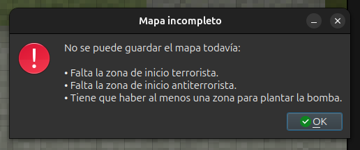

Los avisos en amarillo (por ejemplo, menos de 5 spawns en un equipo) no impiden guardar.

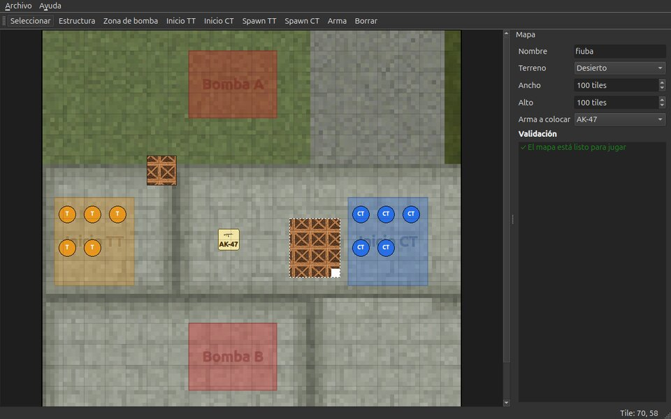

### Jugar tu mapa

Los mapas se guardan como archivos `.yaml` (con `./editor.sh` quedan en la carpeta `~/cs2d-mapas`). Para jugarlo:

1. Copiá el archivo a la carpeta de mapas del servidor:
   ```bash
   sudo cp ~/cs2d-mapas/mi-mapa.yaml /etc/cs2d/maps/
   ```
2. Agregalo a la lista `maps` de `/etc/cs2d/server_config.yaml`:
   ```yaml
   maps:
     - maps/desierto.yaml
     - maps/mi-mapa.yaml
   ```
3. Reiniciá el servidor. Tu mapa aparece en la lista al crear una partida.

---

## Instalación

Requisitos: Ubuntu 24.04. El instalador se encarga de las dependencias (gcc/g++ con C++20, CMake, SDL2, SDL2_image, SDL2_mixer, SDL2_ttf, Qt6 y yaml-cpp).

```bash
git clone https://github.com/martinSaav/counter-strike-2D
cd counter-strike-2D
chmod +x install.sh
sudo ./install.sh
```

El instalador compila el proyecto, corre los tests y deja:

- los ejecutables en `/usr/bin` (`taller_client`, `taller_server`, `taller_editor`);
- las imágenes y sonidos en `/var/cs2d`;
- la configuración en `/etc/cs2d/server_config.yaml` y los mapas en `/etc/cs2d/maps/`;
- los accesos directos `client.sh`, `server.sh` y `editor.sh` en el escritorio.

### Jugar en red

El servidor escucha en el puerto 8080. Para jugar con amigos fuera de tu red, abrí ese puerto en el router y en `client.sh` cambiá `localhost` por la IP pública del servidor. Algunos proveedores de internet bloquean conexiones entrantes aunque el puerto esté abierto.

### Configurar la partida

Todo lo numérico está en `/etc/cs2d/server_config.yaml`:

- cantidad de rondas, plata inicial y premios;
- tiempos de compra, de ronda y de la bomba;
- daño, precisión, cadencia, precio y balas de cada arma;
- ángulo y opacidad del cono de visión;
- qué mapas se pueden elegir (sección `maps`, una ruta por mapa). Cada mapa es un archivo propio en `/etc/cs2d/maps/` que se arma con el editor de niveles.
